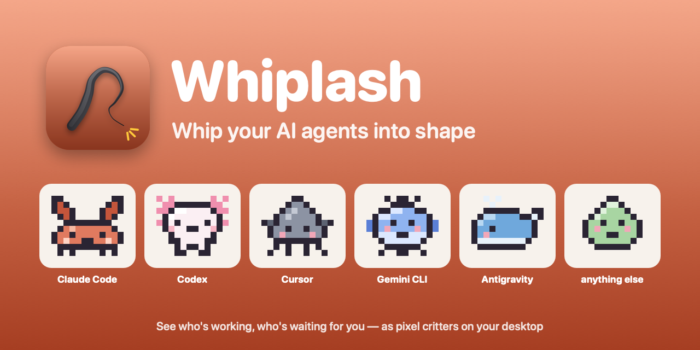
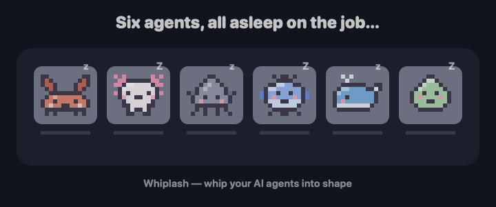
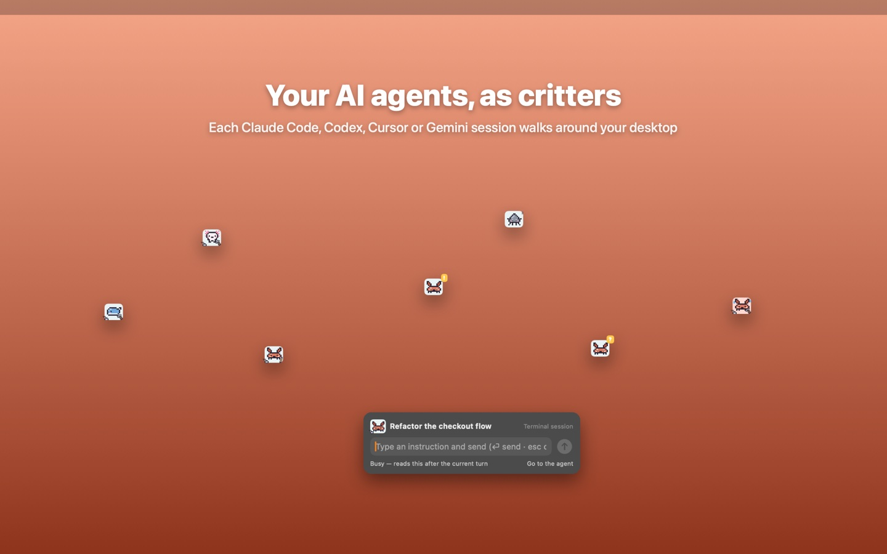
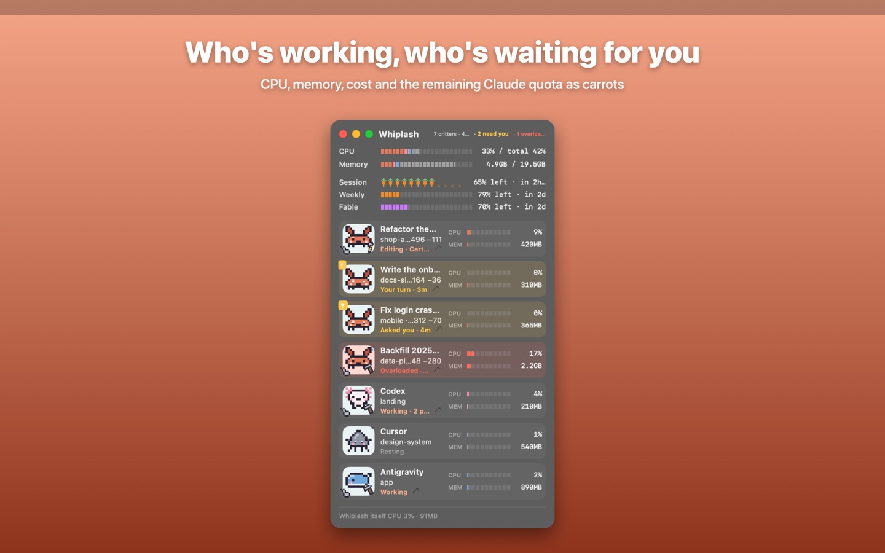
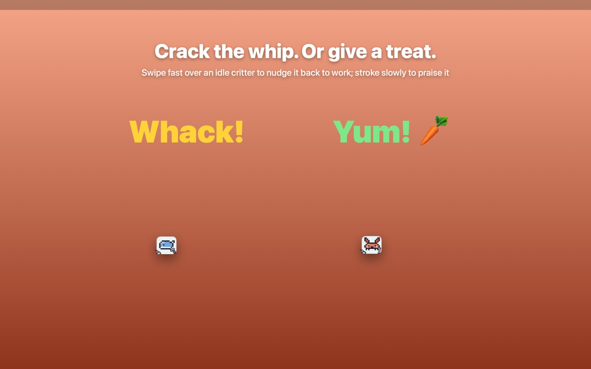
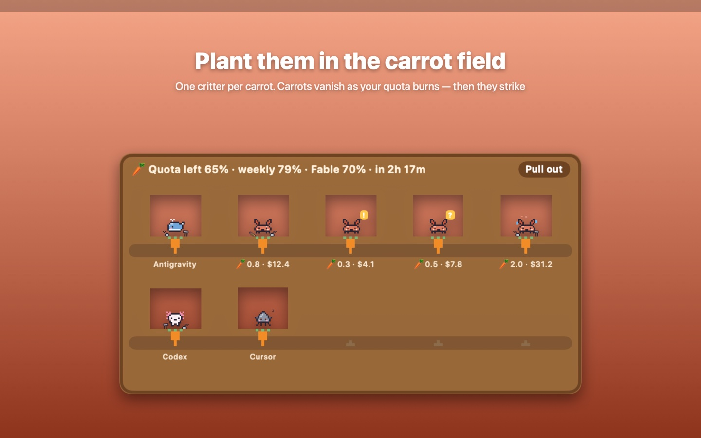
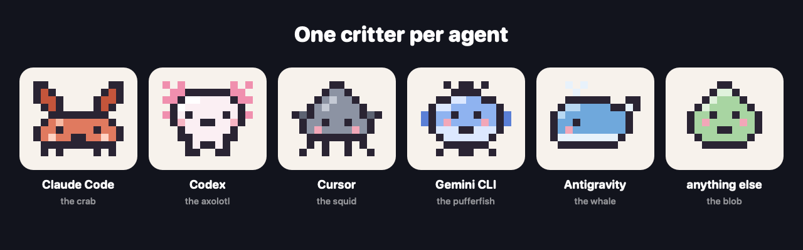

<p align="center">
  
</p>

<p align="center">
  <a href="README.md">English</a> · <a href="README.ko.md">한국어</a> · <b>日本語</b>
</p>

# Whiplash

**AI エージェントに鞭を。**

Whiplash は、あなたのコンピュータで動いている AI コーディングエージェント（Claude Code、Codex、Cursor、Gemini CLI、Antigravity）をピクセルキャラクターで表示します。誰が作業中で、誰があなたの返事を待っていて、誰が CPU を食っているかがひと目でわかります。サボっていたら、鞭を振ればいいのです。

<p align="center">
  
</p>

## なぜ作ったか

エージェントを 5 つ同時に動かすと、数分で誰が何をしているかわからなくなります。1 つは 10 分前に終わって「はい」の一言を待ち、1 つは昼から許可ダイアログで止まり、1 つは静かに CPU コアを 2 つ燃やしています。

Whiplash はそれらを小さなウィンドウひとつにまとめるか、デスクトップに放します。得意技はこれです。一列に並べてポインタでさっと払うと、休んでいたエージェント全員に一度に「続けて」が届きます。

## できること

| | |
|---|---|
|  |  |
| **セッションごとに 1 匹。** デスクトップを歩き回るか、名札を付けて小さなウィンドウに並びます。 | **誰が働き、誰が待っているか。** CPU、メモリ、コスト、変更行数、今していること。 |
|  |  |
| **鞭か、おやつか。** 休んでいるキャラクターの上でポインタを素早く往復させると仕事に戻ります。ゆっくりなでると褒めます。 | **ニンジンは残りのクォータ。** 1 本が残りの Claude 利用量のひとかけら。尽きるとストライキです。 |

ほかにも:

- **手に持つ道具。** 読んでいるときは本、編集中は鉛筆、コマンド実行中はハンマー。あなたの返事が必要なセッションには黄色い吹き出し。
- **エージェントのところへ。** ワンクリックで Claude アプリのそのセッションが開きます。Terminal・iTerm で動くエージェントはそのタブを選びます。
- **メガホン。** 全エージェントに同じメッセージを一度に。
- **過負荷の見張り。** エージェントが何分も CPU を占有していたら、どうするか尋ねるか、カウントダウン後に代わりに止めます。
- **漏えいガード。** エージェントが `git add .env` をしたり、gist を公開したり、秘密鍵を出力しようとしたら、その場で捕まえて元に戻すよう伝えます。
- **体で鞭を打つ。** AirPods で首をひょい、カメラの前で手を振る、マイクに「ヒュッ！」、iPhone・Apple Watch を振る。
- **邪魔をしない。** タイピング中は隠れ、休むとそろそろ出てきます。
- English、한국어、日本語。

<p align="center">
  
</p>

## 入手方法

| プラットフォーム | 場所 | 補足 |
|---|---|---|
| **macOS 13 以降** | Mac App Store | 審査中です。承認されると `apps.apple.com/app/id6832438273` に公開されます。App Store 版はサンドボックス内で動くため、見る・整理する・エージェントのところへ行くまでで、セッションへの入力はできません。 |
| **macOS フル機能** | ソースからビルド（下記） | 鞭プロンプト・おやつ・メガホンのメッセージを Claude Code セッションに直接送り、残りのクォータを表示します。 |
| **Windows 10 以降 / Linux** | [Releases](https://github.com/kade93/whiplash/releases/latest) | Electron 版。Windows は `.zip`・`.msi`、Linux は `.AppImage`・`.tar.gz`。Mac アプリより新しく、検証はまだ少なめです。 |
| **iPhone · iPad · Apple Watch** | [`WhiplashRemote/`](WhiplashRemote/README.md) からビルド | リモコンです。iPhone を鞭のように振るか、一覧から選んで打ちます。App Store にはまだありません。 |

### Mac アプリをソースからビルド

Xcode コマンドラインツールだけで足ります（`xcode-select --install`）。ほかの依存はありません。

```bash
git clone https://github.com/kade93/whiplash.git
cd whiplash
./build.sh --install
```

`swiftc` でコンパイルして `/Applications` に入れ、起動します。メニューバーの鞭アイコンを探してください。

## 鞭の振り方

休んでいるキャラクターの上で少し止まり、ポインタを左右または上下に行って戻します。1 回通り過ぎるだけでは鞭にならず、往復が必要です。キャラクターが跳ねて悲鳴を上げ、そのセッションには続けるか次の作業を選ぶよう短いプロンプトが届きます。プロンプトは編集でき、右クリックメニューから作業を選んで指示することもできます。

数秒以内にもう一度打つと音が大きくなります。*あなたの* 返事を待っているエージェントを何度も打つと言い返します。

ショートカット、テーマ、設定などはユーザーガイドにあります: [日本語](docs/USER-GUIDE.ja.md) · [English](docs/USER-GUIDE.en.md) · [한국어](docs/USER-GUIDE.ko.md)。イースターエッグは [docs/FUN.md](docs/FUN.md) にまとめました。

## プライバシー

Whiplash は何も収集しません。アカウントも、解析も、サーバーもありません。

自分のコンピュータで実行中のプロセス一覧と、Claude Code の場合は `~/.claude` のセッションファイルを読むだけです。カメラ・マイク・AirPods のモーション・ローカルネットワークは該当機能をオンにしている間だけ使い、録画・録音はしません。全文は [docs/PRIVACY.md](docs/PRIVACY.md) にあります。

## 知っておくこと

- Whiplash は独立したプロジェクトです。Anthropic、OpenAI、Anysphere（Cursor）、Google が作ったものでも、公認・提携したものでもありません。
- セッションへのプロンプト送信は Claude Code で動きます。ほかのエージェントは表示・計測・前面表示ができ、CLI が許せば鞭で読み取り専用の補助タスクを起動します。
- 鞭は本物のエージェントに本物のプロンプトを送ります。トークンを消費します。
- すべての権利を留保しています（All rights reserved）。ソースは、読んでいただくことと、ご自身で使うアプリをビルドしていただくために公開しています。再配布や改変版の公開は事前にご相談ください。Issue やアイデアは歓迎します。

## 開発者向け

- `Sources/`: Mac アプリ（Swift、AppKit・SwiftUI、依存なし）。`./build.sh` でビルド、`./build.sh --sandbox` で App Store 版をローカルで作ります。
- `desktop/`: Windows・Linux アプリ（Electron）。[desktop/README.md](desktop/README.md) を参照。
- `WhiplashRemote/`: iPhone・iPad・Apple Watch のリモコン。Mac は UDP 47777 で 1 行のコマンドを受け付けるので、同じ Wi‑Fi 上のものは何でもリモコンになれます。プロトコルは同フォルダの README にあります。
- `tools/`: アイコン、音、スクリーンショット、このページの画像はすべてここのスクリプトで生成しています。
- コミット前フック（`tools/secrets-check.sh`）が鍵・トークン・ホームパス・個人メールのコミットを防ぎます。
- 開発メモ（韓国語）: [docs/NOTES.ko.md](docs/NOTES.ko.md)。
