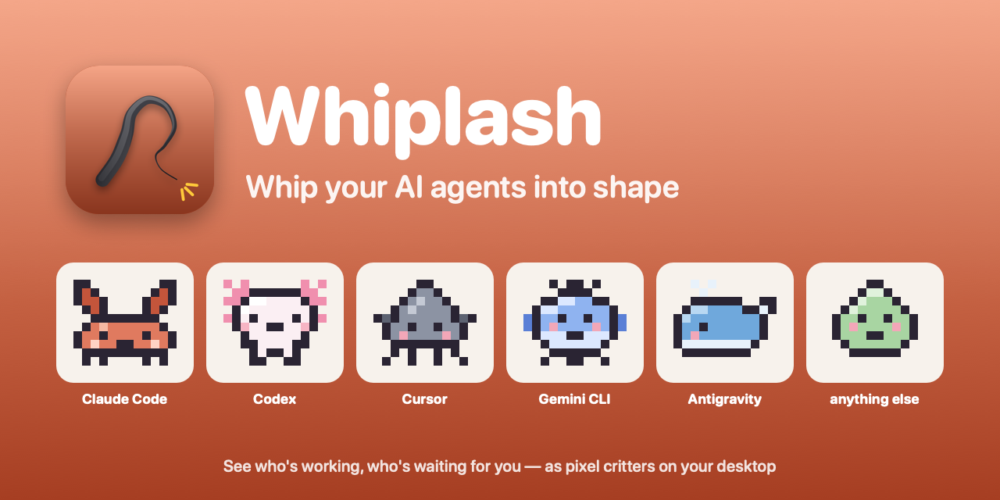
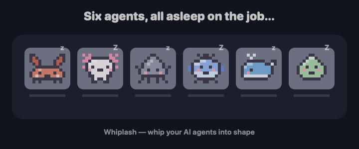
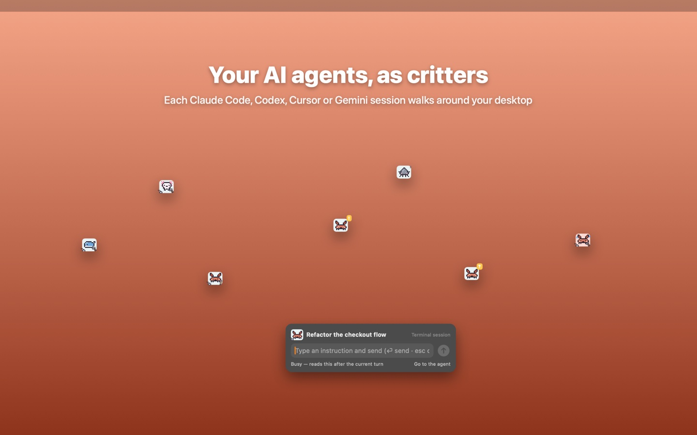
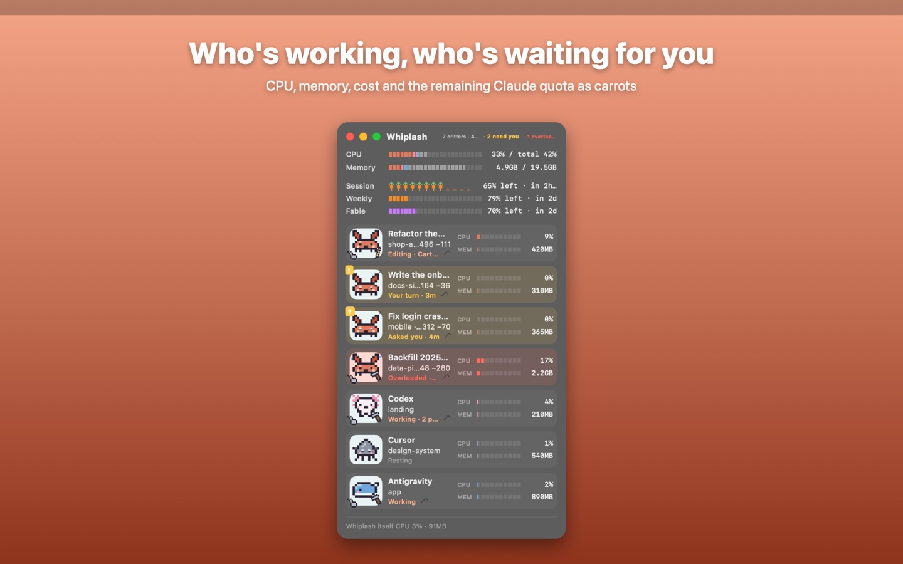
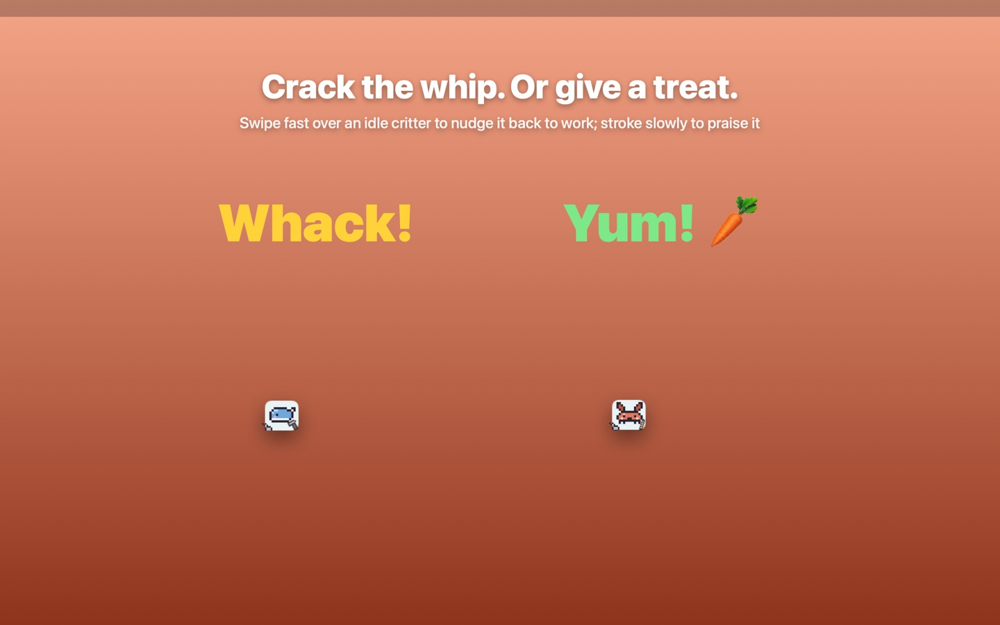
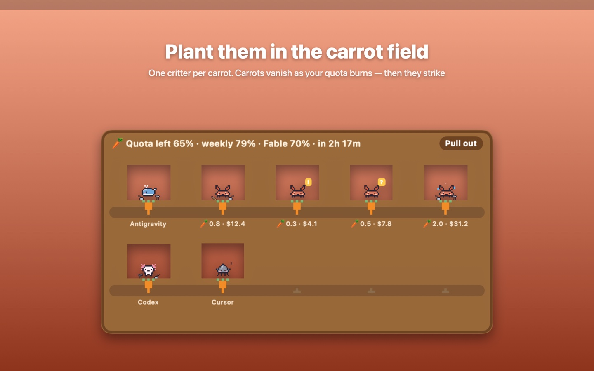
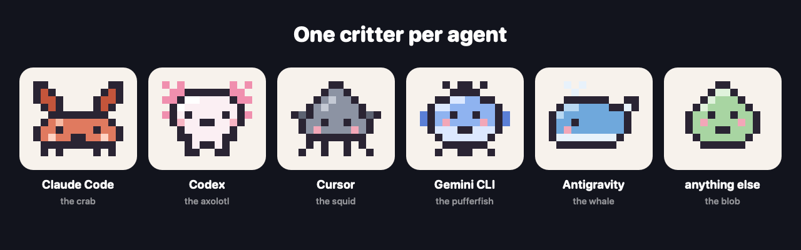

<p align="center">
  
</p>

<p align="center">
  <a href="README.md">English</a> · <b>한국어</b> · <a href="README.ja.md">日本語</a>
</p>

# Whiplash (위플래시)

**내 AI 에이전트들, 채찍질해서 일 시키기.**

Whiplash는 내 컴퓨터에서 돌아가는 AI 코딩 에이전트(Claude Code, Codex, Cursor, Gemini CLI, Antigravity)를 픽셀 캐릭터로 보여 줍니다. 누가 일하는 중이고, 누가 내 답을 기다리고, 누가 CPU를 잡아먹는지 한눈에 보입니다. 농땡이를 피우면 채찍을 휘두르면 됩니다.

<p align="center">
  
</p>

## 왜 만들었나

에이전트를 다섯 개쯤 동시에 돌리면 몇 분 만에 누가 뭘 하는지 놓칩니다. 하나는 10분 전에 끝나서 "네" 한마디를 기다리고, 하나는 점심때부터 허락 창에서 멈춰 있고, 하나는 조용히 CPU 코어 두 개를 태우고 있습니다.

Whiplash는 이들을 작은 창 하나에 모으거나 바탕화면에 풀어놓습니다. 대표 기술은 이겁니다. 줄 세워 놓고 마우스로 한 번 훑으면, 쉬고 있던 에이전트 전부가 한꺼번에 "계속해"를 받습니다.

## 무엇을 하나

| | |
|---|---|
|  |  |
| **세션마다 캐릭터 한 마리.** 바탕화면을 돌아다니거나, 이름표를 단 채 작은 창에 줄지어 앉습니다. | **누가 일하고 누가 기다리나.** CPU, 메모리, 비용, 고친 줄 수, 지금 하는 일까지. |
|  |  |
| **채찍, 아니면 간식.** 쉬는 캐릭터 위에서 마우스를 휙휙 왕복하면 다시 일합니다. 천천히 쓰다듬으면 칭찬입니다. | **당근은 남은 쿼터.** 당근 하나가 남은 Claude 사용량 한 조각입니다. 다 떨어지면 파업합니다. |

그 밖에:

- **손에 든 연장.** 읽는 중엔 책, 고치는 중엔 연필, 명령 실행 중엔 망치. 내 답이 필요한 세션은 노란 말풍선.
- **에이전트에게 가기.** 한 번 누르면 Claude 앱에서 바로 그 세션이 열립니다. Terminal·iTerm에서 도는 에이전트는 그 탭을 골라 줍니다.
- **확성기.** 모든 에이전트에게 같은 메시지를 한 번에.
- **과부하 감시.** 에이전트가 몇 분째 CPU를 붙잡고 있으면 어떻게 할지 물어보거나, 카운트다운 뒤 대신 멈춰 줍니다.
- **유출 감시.** 에이전트가 `git add .env`를 하거나, gist를 공개하거나, 개인 키를 출력하려 하면 현장에서 잡아 되돌리라고 합니다.
- **몸으로 때리기.** 에어팟 낀 채 고개 휙, 카메라 앞 손 휘두르기, 마이크에 「화츅!」, 아이폰·애플워치 휘두르기.
- **방해 안 하기.** 타자를 치는 동안엔 숨고, 쉬면 슬금슬금 기어 나옵니다.
- English, 한국어, 日本語.

<p align="center">
  
</p>

## 받는 곳

| 플랫폼 | 어디서 | 참고 |
|---|---|---|
| **macOS 13 이상** | Mac App Store | 심사 중입니다. 승인되면 `apps.apple.com/app/id6832438273`에 올라옵니다. 앱스토어판은 샌드박스 안에서 돌아서, 보고 정리하고 에이전트에게 가는 것까지 되고 세션에 직접 입력하지는 못합니다. |
| **macOS 전체 기능** | 소스에서 빌드 (아래) | 채찍 프롬프트·간식·확성기 메시지를 Claude Code 세션에 바로 넣고, 남은 쿼터를 보여 줍니다. |
| **Windows 10 이상 / Linux** | [Releases](https://github.com/kade93/whiplash/releases/latest) | Electron 판. Windows는 `.zip`·`.msi`, Linux는 `.AppImage`·`.tar.gz`. 맥 앱보다 새롭고 덜 검증됐습니다. |
| **아이폰 · 아이패드 · 애플워치** | [`WhiplashRemote/`](WhiplashRemote/README.md)에서 빌드 | 리모트입니다. 폰을 채찍처럼 휘두르거나 목록에서 골라 때립니다. 아직 앱스토어에는 없습니다. |

### 맥 앱을 소스에서 빌드하기

Xcode 명령줄 도구만 있으면 됩니다(`xcode-select --install`). 다른 의존성은 없습니다.

```bash
git clone https://github.com/kade93/whiplash.git
cd whiplash
./build.sh --install
```

`swiftc`로 컴파일해 `/Applications`에 넣고 실행합니다. 메뉴 막대의 채찍 아이콘을 찾으세요.

## 채찍은 어떻게 휘두르나

쉬는 캐릭터 위에 잠깐 머문 뒤, 포인터를 좌우나 위아래로 갔다가 되돌아오면 됩니다. 한 번 스쳐 지나가는 건 채찍이 아니고, 왕복해야 합니다. 캐릭터가 펄쩍 뛰며 「아야」 하고, 그 세션에는 계속하거나 다음 일을 고르라는 짧은 프롬프트가 들어갑니다. 프롬프트는 고칠 수 있고, 오른쪽 클릭 메뉴에서 일감을 골라 시킬 수도 있습니다.

몇 초 안에 또 때리면 소리가 커집니다. *내* 답을 기다리는 에이전트를 자꾸 때리면 말대꾸를 합니다.

단축키, 테마, 설정 등 나머지는 사용 설명서에 있습니다: [한국어](docs/USER-GUIDE.ko.md) · [English](docs/USER-GUIDE.en.md) · [日本語](docs/USER-GUIDE.ja.md). 이스터에그는 [docs/FUN.md](docs/FUN.md)에 따로 모았습니다.

## 개인정보

Whiplash는 아무것도 수집하지 않습니다. 계정도, 분석 도구도, 서버도 없습니다.

내 컴퓨터에서 실행 중인 프로세스 목록과, Claude Code의 경우 `~/.claude`의 세션 파일을 읽을 뿐입니다. 카메라·마이크·에어팟 모션·로컬 네트워크는 해당 기능을 켠 동안에만 쓰고 아무것도 녹화·녹음하지 않습니다. 전문은 [docs/PRIVACY.md](docs/PRIVACY.md)에 있습니다.

## 알아 둘 것

- Whiplash는 독립 프로젝트입니다. Anthropic, OpenAI, Anysphere(Cursor), Google이 만들었거나 보증하거나 제휴한 것이 아닙니다.
- 세션에 프롬프트를 넣는 기능은 Claude Code에서 됩니다. 다른 에이전트는 보여 주고, 재고, 앞으로 가져오며, CLI가 허용하면 채찍이 읽기 전용 보조 작업을 띄웁니다.
- 채찍은 진짜 에이전트에게 진짜 프롬프트를 보냅니다. 토큰이 듭니다.
- 모든 권리는 저작자에게 있습니다(All rights reserved). 소스는 읽어 보고 본인이 쓸 앱을 빌드하시라고 공개한 것입니다. 재배포하거나 고친 버전을 내놓으려면 먼저 문의해 주세요. 이슈와 아이디어는 환영합니다.

## 개발자용

- `Sources/`: 맥 앱(Swift, AppKit·SwiftUI, 의존성 없음). `./build.sh`로 빌드하고, `./build.sh --sandbox`로 앱스토어판을 로컬에서 만듭니다.
- `desktop/`: Windows·Linux 앱(Electron). [desktop/README.md](desktop/README.md) 참고.
- `WhiplashRemote/`: 아이폰·아이패드·애플워치 리모트. 맥은 UDP 47777에서 한 줄짜리 명령을 받으므로 같은 Wi‑Fi의 무엇이든 리모트가 될 수 있습니다. 프로토콜은 해당 README에 있습니다.
- `tools/`: 아이콘, 소리, 스크린샷, 이 페이지의 홍보 이미지를 전부 여기 스크립트로 만듭니다.
- 커밋 전 훅(`tools/secrets-check.sh`)이 키·토큰·홈 경로·개인 이메일이 커밋되는 것을 막습니다.
- 만든 과정의 자세한 메모: [docs/NOTES.ko.md](docs/NOTES.ko.md).
