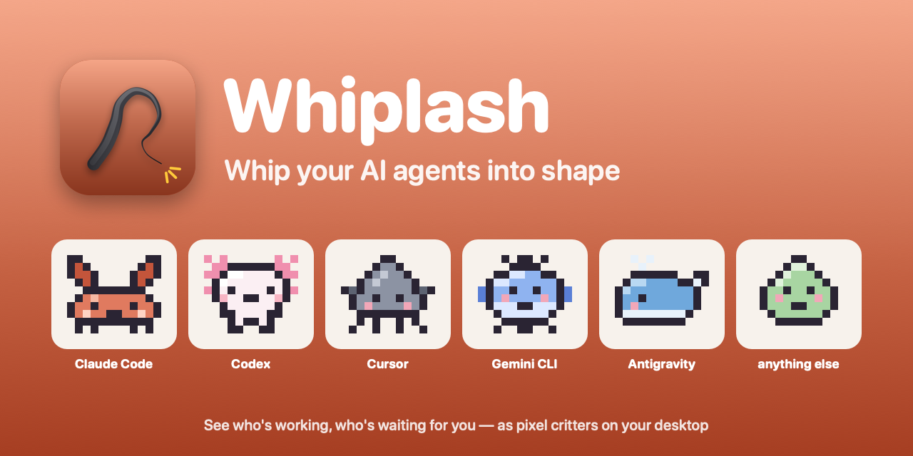
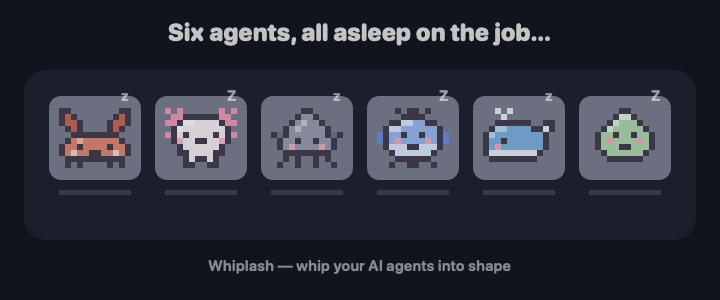
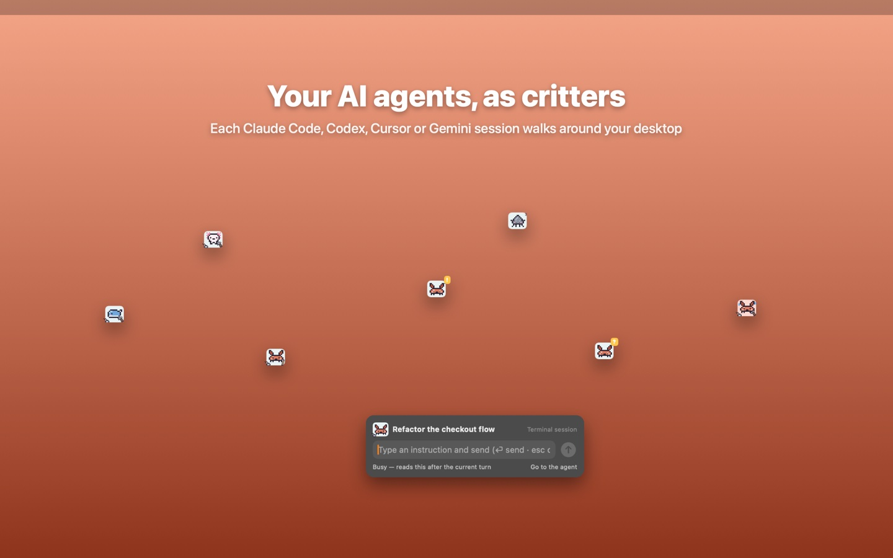
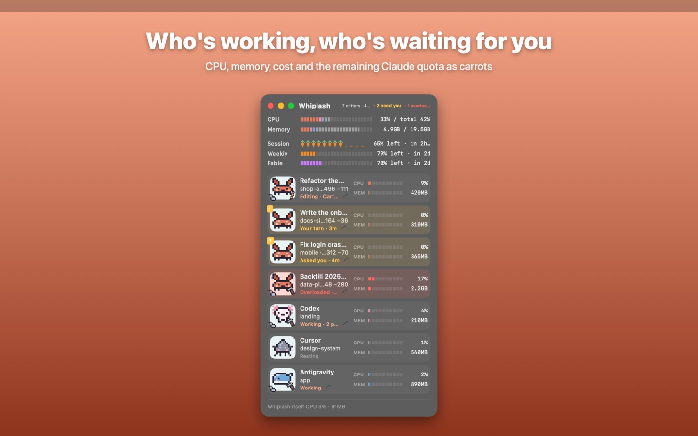
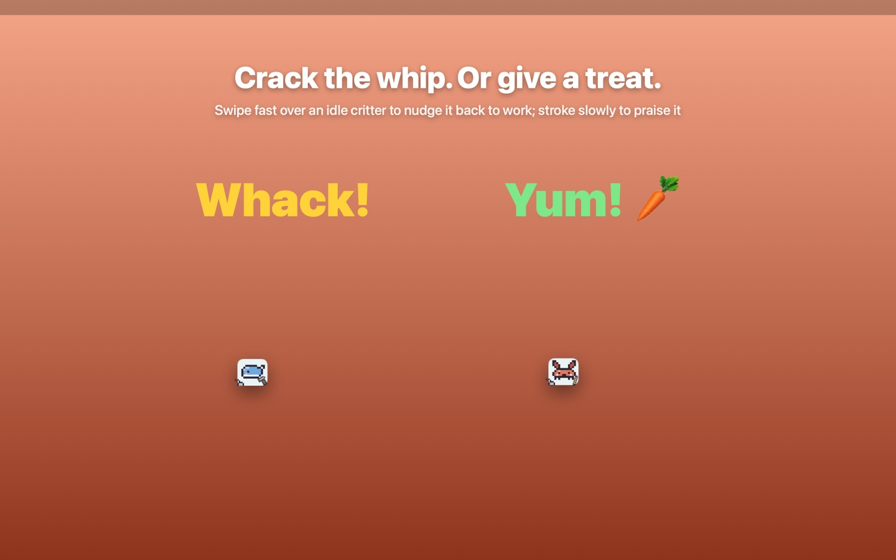
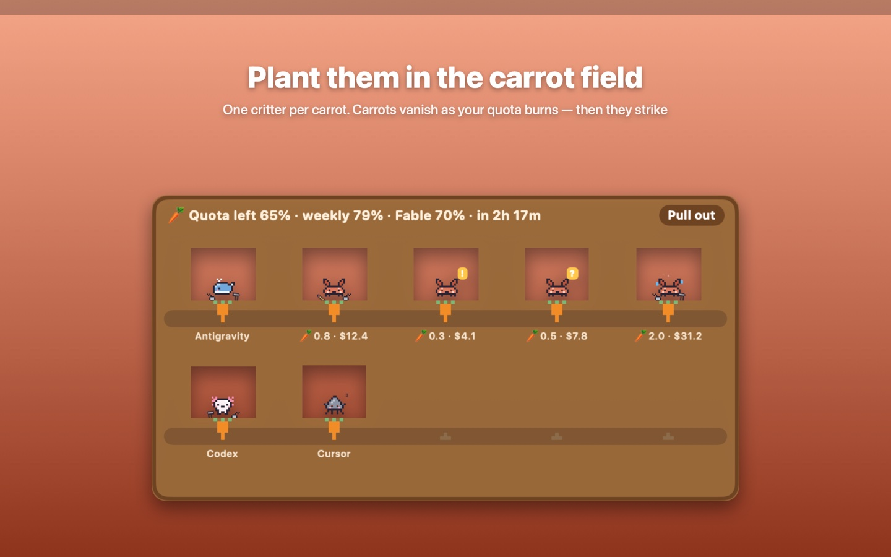
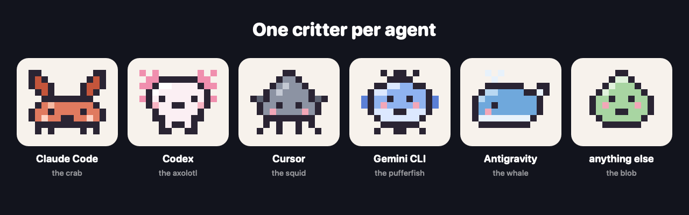

<p align="center">
  
</p>

<p align="center">
  <b>English</b> · <a href="README.ko.md">한국어</a> · <a href="README.ja.md">日本語</a>
</p>

# Whiplash

**Whip your AI agents into shape.**

Whiplash shows every AI coding agent running on your computer — Claude Code, Codex, Cursor, Gemini CLI, Antigravity — as a pixel critter. You see at a glance who is working, who is waiting for you, and who is eating your CPU. When they slack off, you crack the whip.

<p align="center">
  
</p>

## Why

Run five agents at once and you lose track within minutes. One finished ten minutes ago and is waiting for a "yes". Another has been stuck on a permission prompt since lunch. A third is quietly burning two CPU cores.

Whiplash puts all of them in one small window, or lets them roam your desktop. The signature move: line them up, sweep the pointer across, and every idle agent gets a "keep going" at once.

## What it does

| | |
|---|---|
|  |  |
| **One critter per session.** They walk around your desktop or sit in a compact strip with their names underneath. | **Who's working, who's waiting.** CPU, memory, cost, lines changed, and what each one is doing right now. |
|  |  |
| **Crack the whip, or give a treat.** Swipe back and forth over an idle critter to send it back to work. Stroke it slowly to praise it. | **Carrots are your quota.** Each carrot is a slice of your remaining Claude usage. When they run out, the critters go on strike. |

More of what is in the box:

- **A tool in every hand.** A book while reading, a pencil while editing, a hammer while running commands. Sessions that need you get a yellow bubble.
- **Go to the agent.** One click opens that exact session in the Claude app. For agents in Terminal or iTerm it tries to select the right tab.
- **Megaphone.** Send the same message to every agent at once.
- **Overload watch.** When an agent pins your CPU for minutes, Whiplash can ask what to do, or stop it for you after a countdown.
- **Leak guard.** If an agent is about to `git add .env`, publish a gist or print a private key, it gets caught in the act and told to undo it.
- **Whip with your body.** An AirPods head flick, a hand swing in front of the camera, a "whoosh-crack!" into the mic, or a flick of your iPhone or Apple Watch.
- **Out of your way.** Critters hide while you type and sneak back out when you rest.
- English, 한국어, 日本語.

<p align="center">
  
</p>

## Get it

| Platform | Where | Notes |
|---|---|---|
| **macOS 13+** | Mac App Store | In review. It will be at `apps.apple.com/app/id6832438273` once approved. The App Store edition runs in the sandbox: it watches, organises and jumps to agents, but cannot type into their sessions. |
| **macOS, full features** | Build from source (below) | Sends the whip prompt, treats and megaphone messages straight into Claude Code sessions, and shows your remaining quota. |
| **Windows 10+ / Linux** | [Releases](https://github.com/kade93/whiplash/releases/latest) | Electron build: `.zip` or `.msi` for Windows, `.AppImage` or `.tar.gz` for Linux. Newer and less tested than the Mac app. |
| **iPhone · iPad · Apple Watch** | Build from [`WhiplashRemote/`](WhiplashRemote/README.md) | A remote: flick the phone like a whip, or pick an agent from the list. Not on the App Store yet. |

### Build the Mac app from source

You need the Xcode command line tools (`xcode-select --install`). No other dependencies.

```bash
git clone https://github.com/kade93/whiplash.git
cd whiplash
./build.sh --install
```

That compiles the app with `swiftc`, puts it in `/Applications` and starts it. Look for the whip in the menu bar.

## How the whip works

Hover over an idle critter for a moment, then swipe the pointer across it and back, sideways or up and down. Passing over once does nothing; it has to be a real back-and-forth. The critter jumps, yelps, and the session receives a short prompt telling it to continue or pick the next task. You can edit that prompt, or pick a specific task from the right-click menu.

Whip the same one again within a few seconds and it gets louder. Whip an agent that is waiting on *your* answer and it talks back instead.

Everything else, including hotkeys, themes and settings, is in the user guide: [English](docs/USER-GUIDE.en.md) · [한국어](docs/USER-GUIDE.ko.md) · [日本語](docs/USER-GUIDE.ja.md). The easter eggs have their own page: [docs/FUN.md](docs/FUN.md).

## Privacy

Whiplash collects nothing. There is no account, no analytics and no server.

It reads the list of running processes and, for Claude Code, the session files in `~/.claude` on your own machine. The camera, microphone, AirPods motion and local network are used only while you switch the matching feature on, and nothing is recorded. The full text is in [docs/PRIVACY.md](docs/PRIVACY.md).

## Good to know

- Whiplash is an independent project. It is not made by, endorsed by or affiliated with Anthropic, OpenAI, Anysphere (Cursor) or Google.
- Sending prompts into sessions works for Claude Code. Other agents are shown, measured and brought to the front, and a whip starts a read-only helper task where their CLI allows it.
- The whip sends a real prompt to a real agent. It spends tokens.
- No license has been chosen yet, so for now all rights are reserved. Issues and ideas are welcome.

## For developers

- `Sources/` — the Mac app (Swift, AppKit and SwiftUI, no dependencies). `./build.sh` builds it, `./build.sh --sandbox` builds the App Store flavour locally.
- `desktop/` — the Windows and Linux app (Electron). See [desktop/README.md](desktop/README.md).
- `WhiplashRemote/` — the iPhone, iPad and Apple Watch remote. The Mac listens on UDP 47777 for one-line commands, so anything on your Wi-Fi can be a remote; the protocol is in its README.
- `tools/` — icon, sounds, screenshots and the promo images on this page are all generated by scripts here.
- A pre-commit hook (`tools/secrets-check.sh`) blocks keys, tokens, home paths and personal emails from being committed.
- Longer build notes, in Korean: [docs/NOTES.ko.md](docs/NOTES.ko.md).
